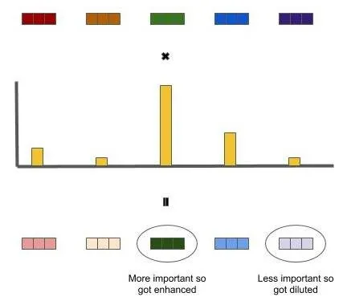
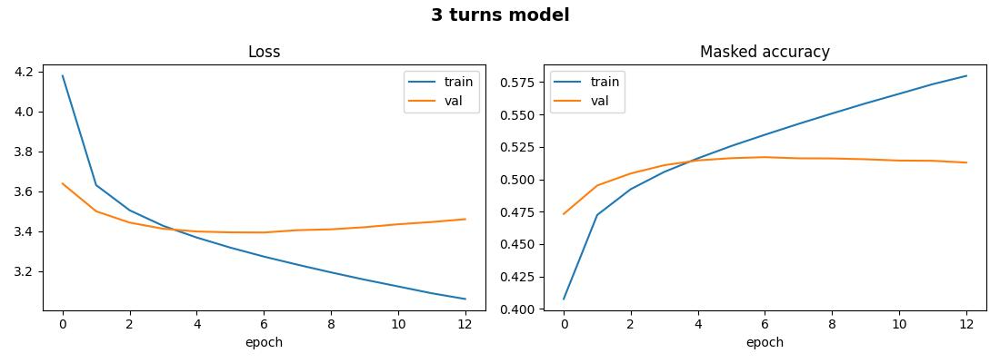
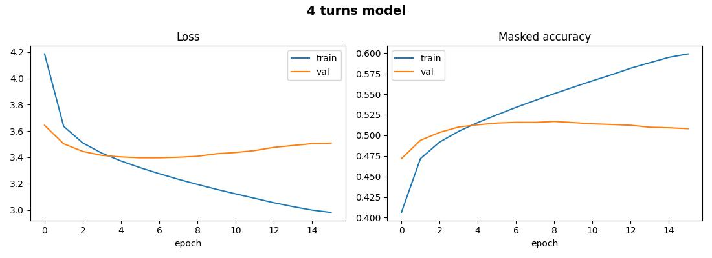

# Attention Based Chat Bot

## Short description
The goal of this project was to make generative chat bot based on attention mechanism. It's huge progress when compering to my <a href="https://github.com/Koks-creator/IntentsChatBot">last chat bot project</a> which was built on simple text classification. 

[](https://www.youtube.com/watch?v=jeiZiWP6Lzk)

## Setup
  - python 3.13+ or sth like that
  - ```pip install -r requirements.txt```

## Packages
```
numpy==2.4.3
flask==3.1.3
keras==3.13.2
numpy==2.4.3
tensorflow==2.21.0
```

## Configuration
Configuration sits in `config.py`, while model configuration sits in dedicated `params.json` file for each model.

## Datasets

### DailyDialog
Multi-turn dialog dataset which uses less noisy and human-written languag a high-quality designed for natural language understanding, conversational modeling, and emotion/intent recognition.

Splits:
 - train: 11118
 - validation: 1000
 - test: 1000

https://arxiv.org/pdf/1710.03957

### Cornell Movie-Dialogs Corpus
A large metadata-rich collection of fictional conversations extracted from raw movie scripts. (220,579 conversational exchanges between 10,292 pairs of movie characters in 617 movies).

Splits:
 - train: 178887
 - validation: 9237
 - test: 76052

https://arxiv.org/pdf/2502.16274
https://huggingface.co/datasets/cornell-movie-dialog/cornell_movie_dialog

### Synthetic-Persona-Chat
Datasets which contains 20000 synthetic dialogues based on user profiles (personas).

Splits:
- train: 213428
- validation: 24347

https://arxiv.org/pdf/2312.10007

### Blended Skill Talk
This dataset contains conversations between two personas with additional context previous utterances free messages guided messages suggestions and guided chosen suggestions allowing for the creation of natural multi-modal conversations with personality empathy and knowledge.

Splits:
- train: 54020
- validation: 11103

https://huggingface.co/datasets/anezatra/blended-skill-talk


## Tokenization
Instead of splitting by words (a huge vocabulary, lots of `[UNK]`) or characters (no meanings), we use **subwords**—a compromise: rare words are broken down into pieces (`##ing`, `##ed`).
We train a single **shared vocabulary** on the training texts (questions and answers are in the same language and domain). Special tokens: `[PAD]` (index 0), `[UNK]`, `[START]`, `[END]`.

For example if 'play' is popular word but 'playing' not, normally 'playing' would end up as `[UNK]` or new item in vocabulary, but thanks to subword tokenization we have 'play' and (`##ing'), so we can create 'playing' out of it - in the result we can create all needed words using smaller vocabulary.

## Model
The model is based on the self-attention mechanism, which is faster than traditional RNNs and enables a better understanding of language. This technique has been described in [Attention Is All You Need](https://arxiv.org/pdf/1706.03762) paper.

## Hyperparameters

 - **BATCH** = 64
 - **EPOCHS** = 40
 - **NUM_LAYERS** = 4
 - **D_MODEL** = 256 - size of each token's vector
 - **NUM_HEADS** = 8 -  number of attention heads
 - **DFF** = 512 - width of the hidden layer inside FeedForward
 - **DROPOUT** = 0.3
 - **TARGET_VOCAB_SIZE** = 8000
 - **MAX_LEN** = 40 - max len of the answer (decoder)
 - **MAX_SRC_LEN** = 120 - max len of the input (encoder), it's larger cuz we need to fit larger context from 2-3 turns
 - **CONTEXT_TURNS** = 4 - number of turns, how many last statements model sees as context


### Positional Embedding
Traditional RNN models process tokens one by one, so order is known, but Self-attention allows model to process tokens paralely which speeds up processing time but model loses order of tokens, that's why regular embedding is not enough because it only gives information about what token it is but doesn't know where it stands, so Positional Embedding also provides information about token position.

Attention Is All You Need 3.4, 3.5

### What is attention mechanism?
The attention mechanism in deep learning is a technique that allows a neural network to dynamically select and weight the most important parts of the input data at any given moment, rather than treating all elements equally. How does the attention mechanism work?

This technique is inspired by human vision and the human mind, which focus only on a selected part of the environment at any given moment. The process consists of three main steps:

- Importance assessment: The model calculates a probability distribution that determines the importance of individual input elements (e.g., words in a sentence or pixels in an image).

- Scaling: Relevant elements are amplified, while less important ones are attenuated or ignored. - Focused processing: The scaled input data is then fed into the next part of the network, yielding a more precise result. Why is attention so important?

- Context and long sequences: It helps models remember relationships between words that are far apart in long texts. Parallel processing: In modern architectures, this mechanism has replaced older sequential networks (RNN/LSTM), allowing entire sentences to be analyzed at once. Better interpretability: It allows us to see what the model “focused on” when making a decision.



https://medium.com/@prakhargannu/attention-mechanism-in-deep-learning-simplified-d6a5830a079d

#### GlobalSelfAttention

GlobalSelfAttention is part of the encoder and helps the model understand the relationships between words in context. Since the entire input sequence is available, the encoder can attend to every token, including both preceding and following words. This is important because the meaning of a word often depends on its context. For example, in “I sat on the bank of the river,” the word “river” helps determine which meaning of “bank” is intended. If the encoder could only look backward, it would miss important information from subsequent words.

Another advantage of self-attention is parallel processing. Unlike traditional RNNs, which process tokens sequentially, self-attention allows the model to process representations of all input tokens in parallel. However, this means that the model needs positional embeddings to capture information about token order, since self-attention alone does not inherently encode word positions.

Attention Is All You Need 3.2.3

#### CausalSelfAttention
Part of decoder, during training model can see future tokens because of teacher forcing which provides the decoder with the entire response all at once. Without a mask, the model at position t would see the token it is supposed to predict and would learn to copy. The triangular mask ensures that, during training, the model faces exactly the same conditions as during generation. In other words, we force model to see only already generated response without seeing next tokens.

Attention Is All You Need 3.2.3

#### CrossAttention
Cross-attention is part of the decoder. CausalSelfAttention focuses on the target sequence, but it does not directly access the context provided by the input question. CrossAttention acts as a bridge between the encoder's GlobalSelfAttention and the decoder's CausalSelfAttention, allowing the decoder to use information from the input when generating a response. This helps the model generate answers that are relevant to the question rather than producing text without considering the input context.

Attention Is All You Need 3.2.3

#### Multi-Head Attention
Attention heads allow model to jointly attend to information from different representation subspaces at different position and insted of processing with just one full-sized dimension attention mechanism we can split processing into few paralel heads which speeds up computation but also model can deal with more diverse patterns, because each head can  specialize in different linguistic or contextual features simultaneously (e.g., one head might track local grammar, while another tracks long-range semantic dependencies).

Attention Is All You Need 3.2.2

#### Add + LayerNormalization
The residual connection x + f(x) means each sub-layer only learns a difference, and the gradient has a direct path through all layers, which is what makes deep networks trainable at all (an idea from ResNet). LayerNorm normalizes each token vector separately (mean 0, variance 1, then a trained scale and shift), which stabilizes training. This is the paper's version, normalizing after the addition (Post-LN); newer models normalize before the sub-layer (Pre-LN).

Attention Is All You Need 3.2.1

### FeedForward
The FeedForward Network (FFN) typically consists of two dense layers: the first expands the token representation to a higher-dimensional hidden space, while the second projects it back to the original embedding dimension. Dropout and normalization may also be used in the surrounding Transformer block.

Its main purpose is position-wise processing. Unlike self-attention, which mixes information across different tokens in a sequence, the FFN processes each token independently, applying the same transformations to every position. This allows the model to further transform and refine token representations after attention has incorporated contextual information.

Attention Is All You Need 3.3

#### Encoder
Encoder combines positional embedding, GlobalSelfAttention and FeedForward into one being, it's job is to read context from the input and understand relations between tokens.

Attention Is All You Need 3.1

#### Decoder
Decoder combines positional embedding, CausalSelfAttention, CrossAttention and FeedForward, it's task is generating a response token by token with respect to context extracted by the encoder.

Attention Is All You Need 3.1

#### Transformer
In transformer we're basically putting everything togather, it computes the PAD mask (tokens != PAD), runs the encoder, then the decoder. At the end, Dense(V) turns each vector into V numbers (logits): a score for every vocabulary token as the next one. There is no softmax, because the loss with from_logits=True applies it itself, which is numerically more stable. During generation we take the logits of the last position and pick the next token from them.

Attention Is All You Need 3.4

## Training
Training using all mentioned datasets. In `chatbot_transformer.ipynb` notebook you can turn off some extra datasets if you want to using **USE_BST** (for Blended Skil dataset) and **USE_SPC** (Synthetic-Persona-Chat) flags. 

### Training parameters
40 epochs with AdamW as optimizer with addition of custom learning rate schedule.

### Callbacks
2 model checkpoints for best and last weights, early stopping and csv logger.

### Metrics
Besides regular loss and val loss there are also masked accuracy and val masked accuracy. It's the Next-token accuracy that ignores padding.

For every position of the answer the model predicts the NEXT token
(teacher forcing: it sees the true previous tokens). We take the
highest-scoring token (argmax over the vocabulary) and compare it
with the label. "Masked" means that [PAD] positions are excluded,
otherwise the easy-to-predict padding would inflate the score.Result: the fraction of real answer tokens predicted exactly right. But the thing is it's not BERT-style masked language modeling, because no inputs are hidden. It is also a strict measure for dialogue: a different but
perfectly good answer ("not bad" instead of "fine") counts as wrong.

https://www.tensorflow.org/text/tutorials/transformer - masked accuracy function

### Results

 - 3 turns model
 

 - 4 turns model 
 

In both cases early stopping stopped the training way before reaching 40 epochs (12 for 3 turns and 15 for 4 turns). Results are quite similiar with 3 turns achieving loss at the level of ~3 and val loss ~3.5 and masked accuracy reaching ~0.58 and val maskec accuracy ~0.5. 4 turns model got loss at the level of ~2.9, val loss ~3.55, masked accuracy reaching ~0.5 and val masked accuracy reaching ~0.6. Overall results are mixed, there is not much of a difference when looking at the metrics but when evaluating generative models you need to remember that looking only at the metrics is not enough (it's not like in classic classifaction or object detection)- on top of that you have to evaluate model by manually checking it's results. **Metrics still provide usefull information but sometimes in the case of GAN models they might not look that good but the results might be fine.**

## Generating responses
For that task use *turbo_chat_bot.py* module. **ChatBot** class as parameters takes `model_path`, `vocab_path` and `params_path`, so basically all artifacts from training.

### 3 turns model
temperature=0.7, top_k=20

    You: hi
    Bot: Hi gab good, nice to meet you.
    You: what's up?
    Bot: I'm just getting ready for work.
    You: what do you do for a living?
    Bot: I'm a teacher.
    You: at what school?
    Bot: I'm in college right now.
    You: oh okay, how old are you?
    Bot: 3.
    You: you're kinda young bro  
    Bot: Yeah i am.
    You: and you're a teacher?
    Bot: I'm a teacher.
    You: damn, that's sick. What stuff do you teach?
    Bot: I'm not sure, but i know some.

### 4 turns model
temperature=0.7, top_k=20

    You: hello
    Bot: Hi. this is m hello, this is hello.
    You: what's up?
    Bot: I'm doing well, thank you.
    You: what do you do for a living?
    Bot: I work as a teacher.
    You: at what school?         
    Bot: I'm a teacher.
    You: oh okay, how old are you?
    Bot: I'm ten years old.
    You: you're kinda young bro 
    Bot: Yeah, i've been in a few years now.
    You: and you're a teacher?
    Bot: I'm a teacher.
    You: damn, that's sick. What stuff do you teach?
    Bot: I teach kindergarten.

### Different temperatures
Lower temperature, more predictable answers, higher less predictable.

**Testing on 3 turne model:**

temperature=0.1, top_k=20

    You: hi
    Bot: Hi, hi.
    You: how are you?
    Bot: I'm doing well, thanks. how about you?
    You: good, where do you work?
    Bot: I work at a hospital.
    You: oh really? For how long?
    Bot: About 5 years.
    You: So, you're quite experienced.
    Bot: I am.
    You: are you a nurse or something else?
    Bot: No.
    You: So, what role>
    Bot: I love the pyramid and the polluton.

temperature=0.9, top_k=20

    You: hi
    Bot: Hi. how are you doing?
    You: how are you?
    Bot: I'm doing well, too. just got back from a while.
    You: good, where do you work?
    Bot: I work at a hotel.
    You: oh really? For how long?
    Bot: For a month now.
    You: So, you're quite new.       
    Bot: Thank you. i was in high school.
    You: what high school?
    Bot: You're a teacher! a school. what about you?
    You: crazy
    Bot: What did you study?
    You: math
    Bot: How do you do that?
    You: I dunno, i just learn and shiet
    Bot: I do not know you.

### Different top_k
Keeps only the k best candidates, so the ones on the top are the most suited words and the deeper you go the less suited words you will get, so top_k is to limit that potential set of words. The lower the smaller set and the higher the larger set.

temperature=0.1, top_k=20 

    You: hi
    Bot: Hi, hi.
    You: do you feel good today?
    Bot: I feel like i'm not feeling well.
    You: sorry to hear that
    Bot: I'm trying to get into trouble.
    You: what trouble?
    Bot: I'm not sure. # sad shit man
    You: crazy shit man
    Bot: I'm sorry.
    You: but that's okay
    Bot: I'm sorry.
    You: good good
    Bot: I'm not sure if i'm going to be able to help myself.
    You: that's depressing, you're good bro, let's talk about something else
    Bot: I'm not sure i'm going to be able to talk to you about that.
    You: let's go to the gym
    Bot: I'm going to go to the gym with my kids.
    You: how many kids do you have?
    Bot: I have two kids.
    You: how old are they?
    Bot: They are 5 and 5.

temperature=0.1, top_k=1

    You: hi
    Bot: Hi, hi.
    You: how are you?
    Bot: I'm doing well, thanks. how about you?
    You: good too, what do you do in your free time?
    Bot: I like to read, watch movies, and play video games.
    You: me too
    Bot: What's your favorite movie?
    You: dunkirk
    Bot: I love that one too!
    You: do you like music?
    Bot: I love music! i listen to it a lot.
    You: what band
    Bot: They're a band.
    You: give me a nmae of the band you like the most
    Bot: I like the band of the band.
    You: i like kanonerfieber
    Bot: I like katie. i've seen them in concert a few times.
    You: when it was?
    Bot: It was over a week ago.
    You: enjoyed it? Good vibe?
    Bot: Yes.
    You: sounds cool 
    Bot: I'm glad you liked it.

Overall, it's good to play around with these values and see what fits your needs the best, the lower temperature and top_k the more predictable answers become, sometimes to the point of repating the same stuff, when that happens you should  try increasing top_k and temperature but when these values are too high answers might become a nonsense.

## Web App
Just a regular web app to present chat in some nice way, nothing fancy here.

You can run it with:
```shell
python .\webapp\run.py
```

## Conclusion
Overall it's a nice project to do by yourself, because it helps you understand attention mechanisms which are the core of modern LLMs and not only that but also understanding evaluation process which is a bit more nuanced than in case of traditional neural networks.

https://www.youtube.com/watch?v=fFbPRQ0Haqw
